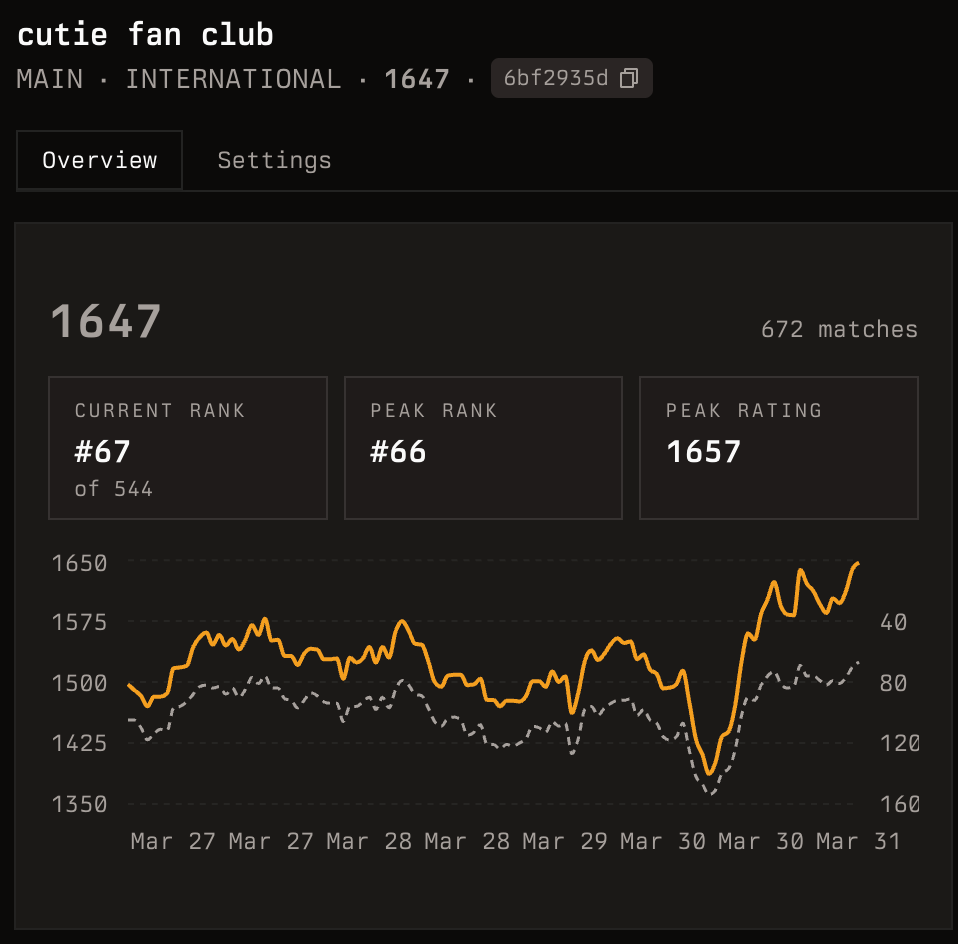

# jon-4

Model number 4 from @jloh02

## Result

## Features
- A* search algorithm
- Explore when no ore in view
- Connect harvesters to nearest conveyor

## TODO for jon-4
[x] Optimize A*
[x] Reduce duplicate work using markers
[ ] While tiling back, handle case of other bot blocking and need to destroy the road
[ ] Heal core to defend rush strat
[ ] Increase cost of building new road to prioritize walking on existing road
[ ] Bridge when no path to move (shish_kebab map)
[ ] Reduce conveyor congestion by limiting number of tags to same conveyor
[ ] Build defense around harvesters
[ ] Axionite collection
[ ] Use barriers to cover ores
[ ] Surveyor mode for builder bots with nothing to do
    [ ] they will check flow lines and repair
    [ ] also check if flow lines require split into core
[ ] Bot-collisions
[ ] Marker for explored regions + ores