# Assault State Machine Review

This document describes the actual assault control flow in `jon-6-a5bfs`, including the hidden memory/state that is not obvious from `assault_subrole` alone. It also records the `v3` replay-backed failure modes and the main design problems in the current planner/navigation split.

Files covered:
- `builder_bot.py`
- `mode_assaulting.py`
- `assault.py`
- `navigation.py`
- `perception.py`
- `utils.py` marker/claim hooks where relevant

## 1. Top-Level Assault Control Flow

The assault bot has fewer named states than actual decision layers. The top-level mode is always `BuilderMode.ASSAULTING`, but per turn it can go through:
- spawn bootstrap state
- global inference state
- anchor selection state
- committed-site reuse / invalidation state
- local execution subrole
- navigation internal state (`bfs_path` vs bug/wall-follow)

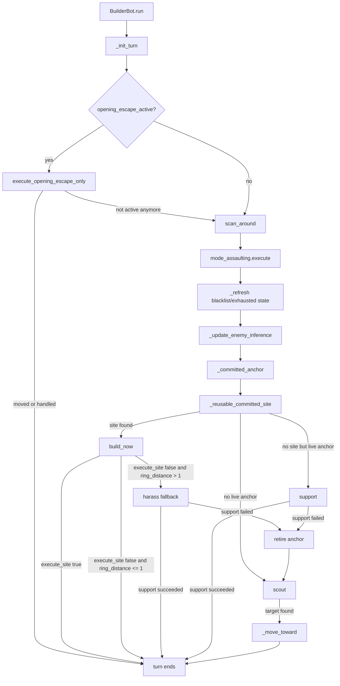

## 2. Actual Named States

The real named subroles are:
- `opening_escape`
- `build_now`
- `wait_adjacent`
- `harass`
- `support`
- `scout`

Important caveat:
- `wait_adjacent` is not a true top-level state machine branch.
- It is a remembered condition inside `assault_wait_state`.
- The next turn still re-enters `execute()`, recomputes anchor/site logic, and only then may fall back into the same adjacent-wait behavior.

## 3. State Flowcharts

### 3.1 `opening_escape`

Trigger:
- `is_assault_role`
- `assault_opening_escape_complete == False`
- current position still inside the core shell

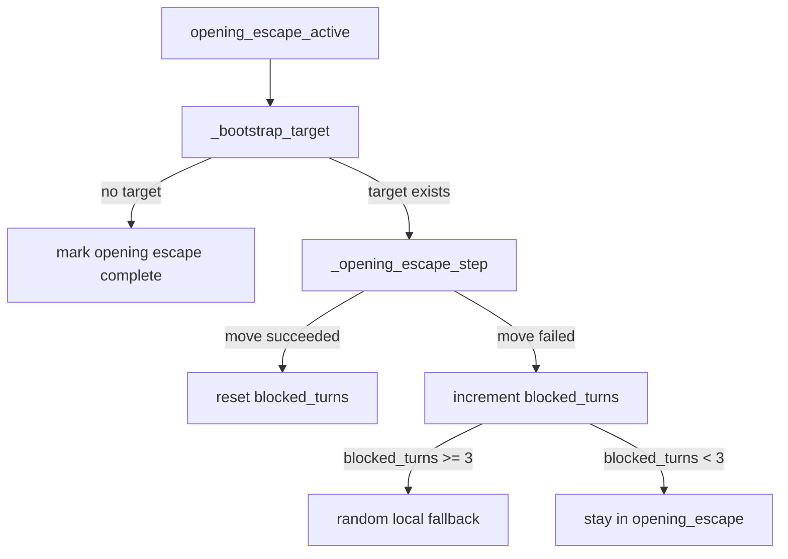

Current transition notes:
- no perception runs on the short-circuit opening path
- target is cached in `assault_bootstrap_state`
- exit is purely geometric: leave the spawn shell

### 3.2 `build_now`

Entry condition:
- there is a committed site, or a fresh best site is chosen

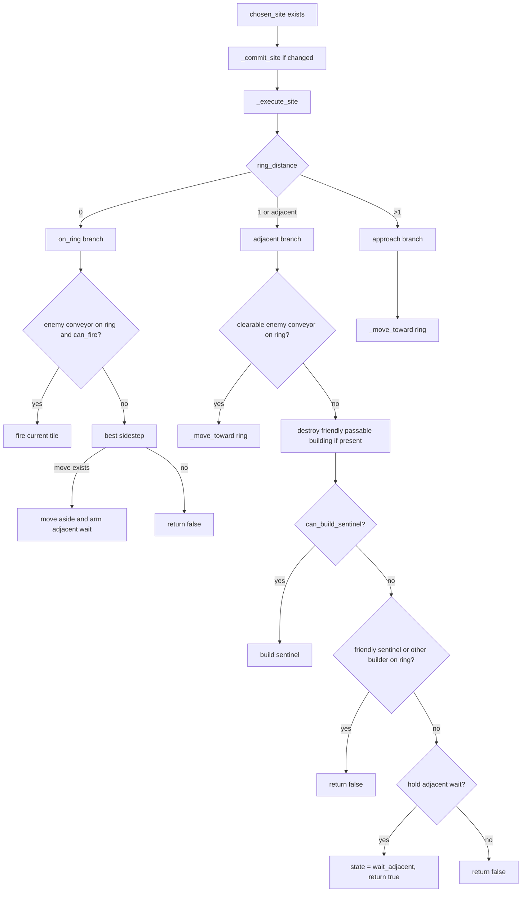

Post-`_execute_site` decisions inside `execute()`:

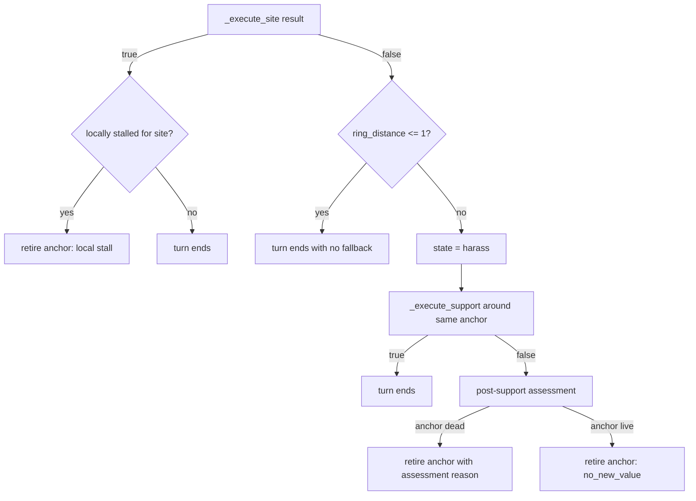

Important hidden behavior:
- a failed movement/execution while still far from ring can retire the anchor after one support attempt
- this mixes navigation failure with strategic invalidation

### 3.3 `wait_adjacent`

This is not a real independent state. It is encoded in `assault_wait_state`.

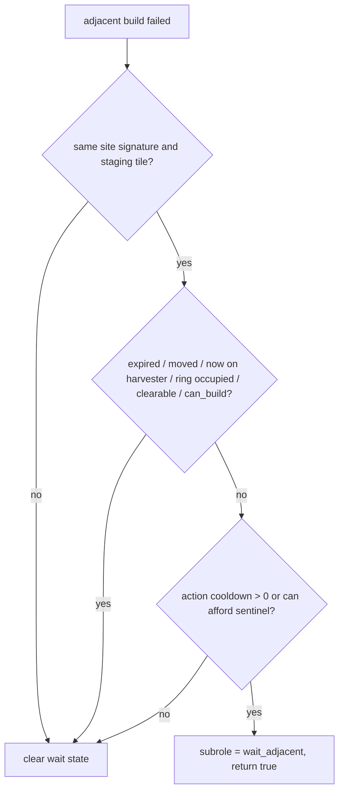

Why this matters:
- the bot looks like it has a stable wait state
- in reality it still recomputes planner context every turn before deciding to wait again

### 3.4 `harass`

This is only reached as a fallback from `build_now` when `_execute_site` fails and the bot is not adjacent/on-ring.

```mermaid
flowchart TD
    A[build_now failed far from ring] --> B[subrole = harass]
    B --> C[_execute_support(anchor, site, forbidden_position=ring)]
    C -->|success| Z[turn ends]
    C -->|fail| D[reassess anchor]
    D -->|anchor dead| E[retire anchor]
    D -->|anchor still live| F[retire anchor: no_new_value]
```

This is strategically very aggressive:
- one move/execution failure can immediately flip into harassment
- one failed harassment attempt can retire a still-live anchor

### 3.5 `support`

Entry condition:
- live anchor exists, but no site chosen or committed

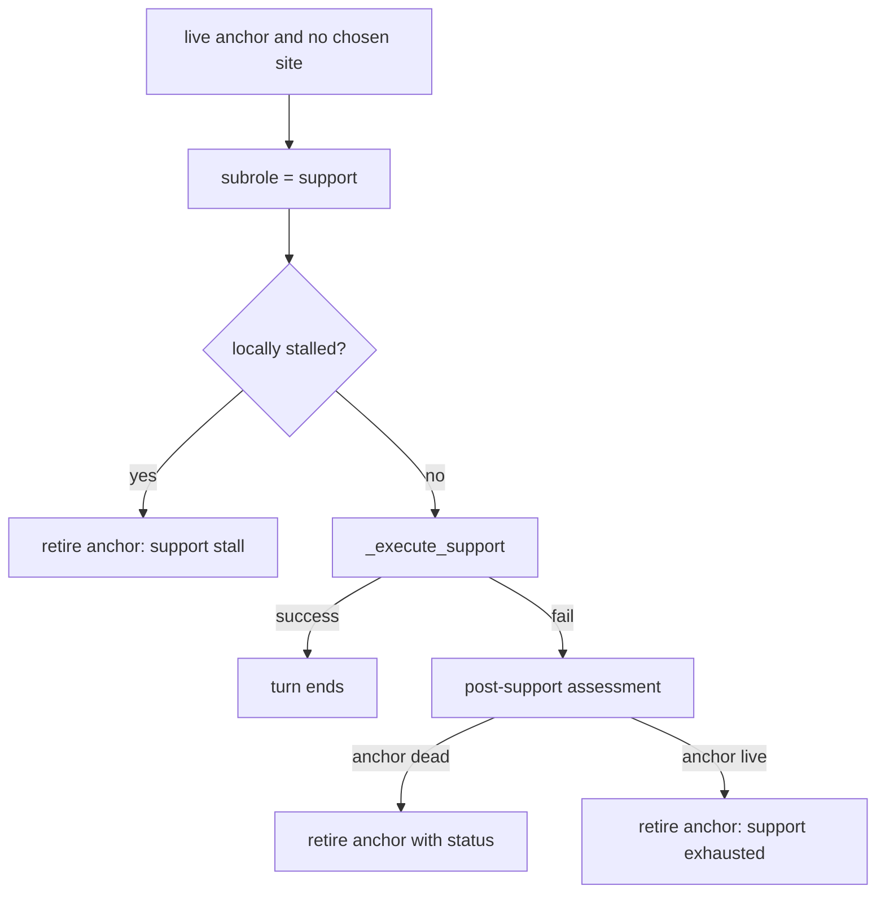

`_execute_support` itself:

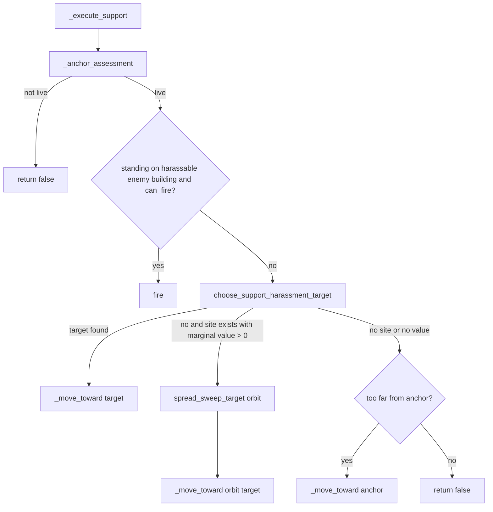

### 3.6 `scout`

Entry condition:
- no chosen site
- no live anchor after support path

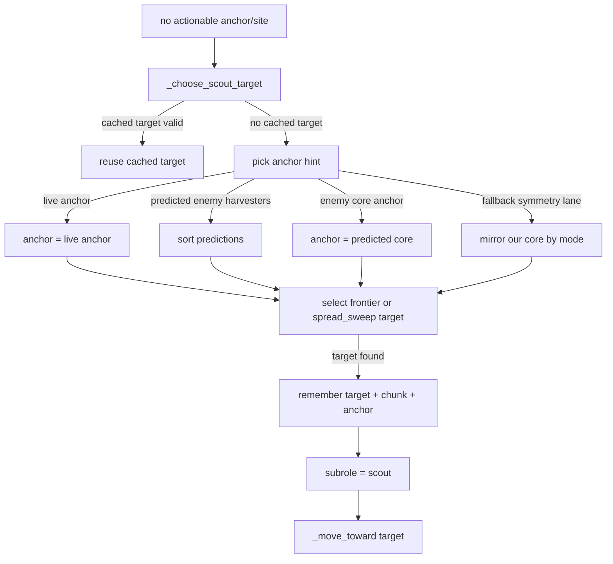

Current scout target sources overlap:
- cached scout target
- live anchor
- predicted enemy harvesters
- predicted enemy core
- symmetry-mode lane fallback
- local frontier around anchor
- global frontier over all chunks
- legacy `spread_sweep_target`

## 4. Hidden State Machines That Matter More Than `assault_subrole`

### 4.1 Anchor Lifecycle

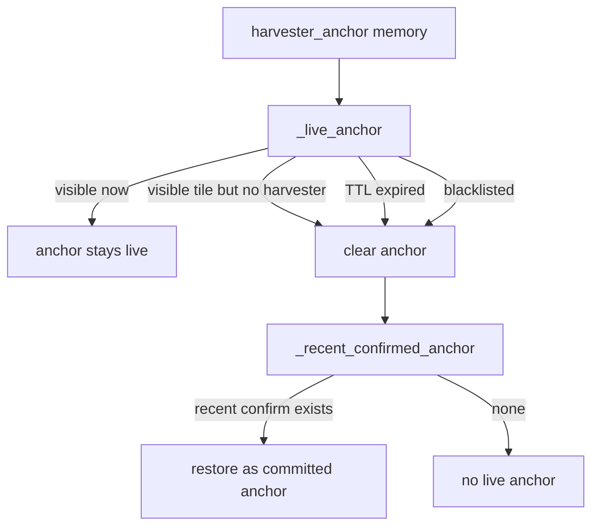

Anchor retirement reasons:
- `local stall`
- `support stall`
- `support exhausted`
- `no_new_value`
- `captured`
- `dried`
- `saturated`
- `good enough`

These reasons are used both as:
- strategic lifecycle decisions
- congestion/pathfinding failure responses

That coupling is one of the main design problems.

### 4.2 Committed Site Lifecycle

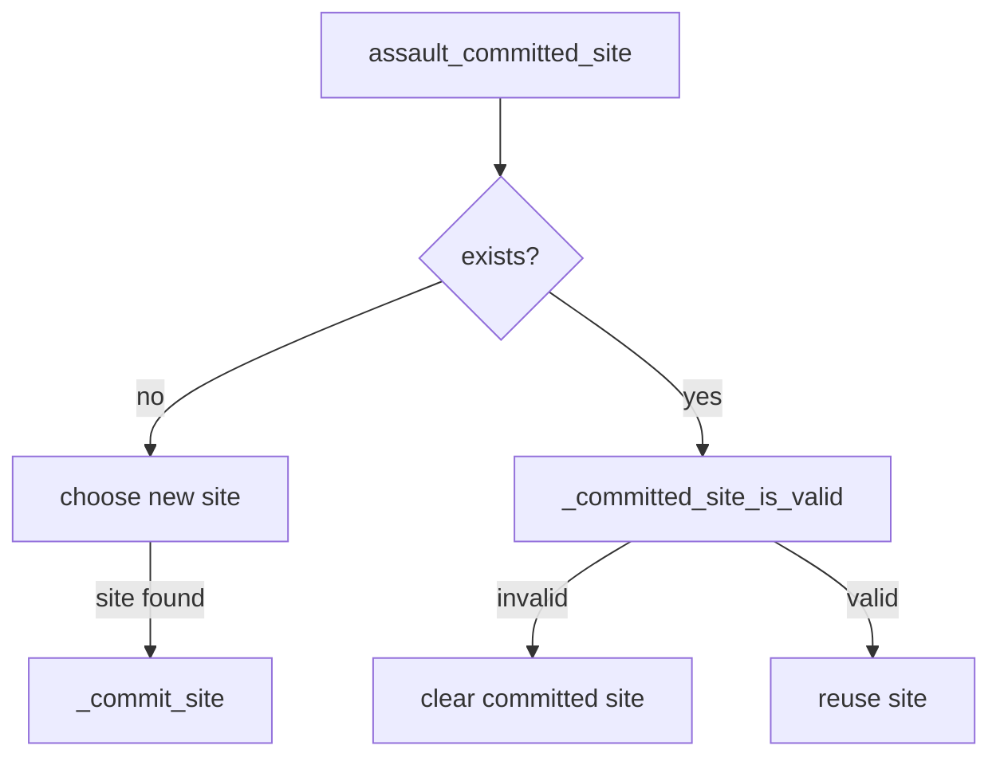

Validity depends on:
- commit age
- anchor blacklist/exhausted-region status
- local claim status
- anchor assessment still live
- ring classification still `IMMEDIATE` or `CLEARABLE`

This means a committed site can still invalidate because of:
- visibility changes
- classification changes
- live anchor/assessment changes
- absent coordination claims

### 4.3 Assault Navigation Internal State

`mode_assaulting._move_toward()` hides another state machine:

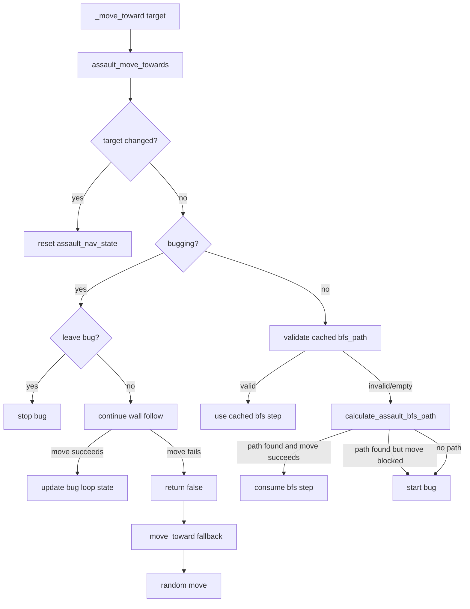

Important details:
- assault navigation has separate `assault_nav_state`
- but it reuses generic `pathfinding_state["known_obstacles"]` and `temporary_obstacles`
- when `assault_move_towards()` returns `False`, caller does `utils.move_random(ct)`

That last step is a major contract break:
- planner asked for a specific target
- navigator failed to make progress
- caller discards the failed-navigation reason and performs an unrelated random move

## 5. Replay-Backed `v3` Failure Patterns

The `v3` server replays show that the remaining failures are not just cold-start spawn issues.

Observed pattern classes:

### 5.1 Early healthy turns, then wall-side hot loop

Examples from diagonal-spawn assault builders:
- `game_2` bot `22`: first hot turn at round `40` after repeating `(14,34) <-> (13,33)` near the wall approach
- `game_3` bot `27`: first hot turn at round `130` after repeating `(14,26) <-> (13,26)`
- `game_5` bot `29`: first hot turn at round `160` after repeating `(5,2) <-> (6,2)`

Interpretation:
- opening escape succeeded
- first tens of turns were cheap
- the hot loop starts later when target chasing meets map geometry

### 5.2 Pure 2-tile / 3-tile assault loops

Examples:
- `game_2` bot `22` and `25`
- `game_3` bot `32`
- `game_4` bot `444`

These are not “stuck because no move exists” loops. They are planner-navigation disagreement loops:
- target remains conceptually similar
- local motion alternates between a few legal tiles
- after enough turns, server exec time rises to repeated `~2100 us`

### 5.3 Conveyor / harvester adjacency hot turns

The replay symptom “TLE on a conveyor tile next to a harvester” matches a specific hot path:
- a blocked friendly builder on a logistics lane triggers `_is_connected_to_harvester()`
- `_is_connected_to_harvester()` performs a reverse DFS over the whole connected local conveyor component
- this happens in a movement-failure branch, so it can repeat every turn in the worst congestion pockets

### 5.4 Late-spawn assault builders can still enter the same loops

Several later diagonal spawns are fine for their first few turns and then hit the same pattern once they reach the same frontier or wall geometry. This means the remaining issue is now structural, not just a spawn-shell bootstrap bug.

## 6. Deep Analysis

## 6.1 The state machine is flatter on paper than in reality

The current bot looks like it has six assault subroles, but in practice it has at least four overlapping state layers:
- assault subrole
- anchor lifecycle
- committed site lifecycle
- navigation lifecycle

This creates hidden state combinations such as:
- `build_now` + stale committed site + bugging
- `support` + anchor still live + no harassment target + global scout retarget next
- `wait_adjacent` + recomputed chosen site + changed ring classification
- `scout` + cached target normalized to a nearby staging tile + navigation reset

That makes the bot hard to reason about and easy to destabilize.

## 6.2 Planner and navigation speak through a target tile only

The current interface is:
- planner chooses a `Position`
- navigator tries to get there
- if navigator fails, caller may random-move or retire the anchor

What is missing:
- target class: scout frontier vs ring approach vs temporary staging vs harassment lane
- failure reason: hard wall, friendly congestion, enemy builder, unreachable target, stale obstacle memory
- local progress signal: “still moving around obstacle” vs “no progress for 12 turns”

Because the contract is only `target_pos`, the planner cannot react intelligently to navigation failure.

## 6.3 `build_now` conflates strategy failure with pathfinding failure

This is one of the biggest logic errors.

Current behavior:
- `_execute_site()` may fail because move/build was blocked
- if far from ring, bot immediately flips into `harass`
- one failed support turn can retire the anchor as `no_new_value`

This means:
- inability to path to the ring can be misread as “anchor strategically exhausted”
- local congestion can erase a good committed site
- retargeting churn is created by navigation trouble, not by new information

This is a major source of ping-pong.

## 6.4 `wait_adjacent` is not a real state, so it is more expensive than it looks

The bot appears to have an adjacent waiting mechanic, but it is only a remembered condition checked after the planner has already rebuilt context for the turn.

Practical effect:
- adjacent builders still pay most of the outer assault execute path
- repeated adjacent turns continue to re-enter global anchor/site logic
- the state is not locally sealed off enough to stay cheap

## 6.5 The claim/coordination layer is conceptually present but functionally broken

The bot clearly expects local assault-claim coordination:
- `_publish_assault_claim()`
- `_is_locally_claimed_assault_anchor()`
- perception decoding of assault claim markers

But `utils.place_marker_around()` is stubbed to always return `False`.

Result:
- assault claims are never actually published
- `claimed_assault_anchor_keys` never gets meaningful new data from teammates
- multiple assault builders can converge on the same anchor/ring with no real deconflict

Game-mechanically, this is important:
- congestion near the same anchor is more likely
- the planner acts as though claims exist, but they do not
- anchor invalidation and delegation heuristics become less trustworthy

## 6.6 Assault navigation is still algorithmically dangerous on large wall maps

The single biggest navigation concern is this:
- `calculate_assault_bfs_path()` is an unbounded BFS
- unlike economic A*, it has no explicit iteration or time budget

That is a severe mismatch for maps like `binary_tree` and `cubes`:
- if target is around a large wall, BFS can scan most of a large connected region
- if target changes often, the bot can pay this cost repeatedly
- if path is blocked and bug restarts or target normalizes differently, the same region can be rescanned

This aligns directly with the wall-side TLE reports.

## 6.7 BFS and Bug 2 are fighting each other

The current assault navigator alternates between:
- direct BFS route replay
- bug/wall-follow
- exit-bug as soon as any progress step is possible on the M-line

This creates oscillation risk:
- target changes reset nav state
- even a small target normalization can throw away bug state
- leaving bug is eager once a goal-progressing step is visible
- if the path is still globally bad, bot re-enters BFS then re-enters bug again

That is exactly how you get 2-tile and 3-tile frontier ping-pong.

## 6.8 Random fallback is toxic here

`_move_toward()` does:
- try `assault_move_towards()`
- if that returns `False`, call `utils.move_random()`

This is a bad fit for a committed assault plan because:
- it invalidates the geometric meaning of the target
- it is not reflected in planner state
- it can create accidental local oscillation
- it can move the bot onto conveyors or corners that trigger more expensive next-turn logic

A competitive-programming style controller should not random-step after a structured navigation failure unless it is in a tightly bounded local escape mode.

## 6.9 Scout targeting is too layered and too global for a unit that is often blind

Scout target selection currently mixes:
- cached target reuse
- predicted harvester ranking
- symmetry selection
- local frontier around anchor
- global frontier over all chunks
- legacy sweep target fallback
- target normalization to a nearby viable tile

This has several costs:
- too many target-generation systems
- weak hysteresis
- target identity can change even when strategic intent has not changed
- global frontier scan over all chunks is still expensive on large maps

Game-mechanically, assault scouts probably do not need this much sophistication before seeing real enemy structure.

## 6.10 `assess_anchor()` duplicates the planner

`assess_anchor()` calls `rank_assault_sites_for_harvester()` again to decide anchor status. That means anchor lifecycle depends on rerunning the same site planner used for actual build selection.

Problems:
- duplicate work
- status depends on planner artifacts, not only on strategic facts
- a navigation-induced site problem can cascade into an anchor retirement decision

This is too recursive.

## 6.11 Conveyor-adjacent TLE has a concrete cause

The “TLE next to a harvester/conveyor” observation is not vague. The likely direct cause is:
- move blocked by a friendly builder
- movement code calls `_is_connected_to_harvester(next_pos)`
- `_is_connected_to_harvester()` DFSes through the whole local friendly conveyor component
- same situation repeats next turn

That means a locally congested logistics knot can repeatedly trigger:
- expensive connectivity checks
- temporary-obstacle rewriting
- planner retries on top

This is a real hot path and should be treated as one.

## 6.12 Some heuristics do not match the map class

The current assault heuristics make more sense on open maps than on maze maps:
- `spawn_slot` lane bias is useful for spreading, but too rigid once walls dominate
- `spread_sweep_target()` is geometric, not corridor-aware
- ring frontness / outward pressure are good as a tactical tie-break, but not enough to choose where to approach on heavily partitioned maps

On maps with strong wall structure, the bot needs:
- stable corridor-level objectives
- or at least staged targets that respect obstacle topology

Exact ring tiles are often too brittle as long-range goals.

## 7. What Overlaps or Does Not Make Sense

### Overlaps
- `support` and `harass` both call `_execute_support()`; they are behaviorally very close
- `assess_anchor()` and `choose_best_site_for_harvester()` both rerun the same ranking core
- `scout` target selection has both frontier logic and legacy spread-sweep logic
- assault coordination exists both as claim markers and visible-builder delegation, but one path is broken and the other is only partial

### Inefficient or structurally risky pieces
- unbounded assault BFS
- repeated bug/BFS switching near walls
- random fallback after structured nav failure
- `_is_connected_to_harvester()` in repeated congestion loops
- global scout frontier scan when the bot still lacks a stable corridor objective
- adjacent wait implemented as a soft remembered condition instead of a cheap sealed local state

### Heuristics that are questionable as game mechanics
- retire a live anchor after one failed support turn
- treat pathfinding failure as evidence of `no_new_value`
- rely on claims for deconflict while claim publication is disabled
- use global symmetry/predicted-harvester logic every turn for scouts that are still fighting map geometry

## 8. Most Likely Root Causes Of The Current `v3` Symptoms

### Ping-pong after spawn escape
Most likely caused by:
- target churn in scout/build fallback
- bug/BFS reset behavior
- `_move_toward()` random fallback
- strategy invalidation caused by navigation failure

### TLE near walls
Most likely caused by:
- unbounded assault BFS on large connected regions
- repeated BFS re-entry after eager bug exit
- frequent target resets near frontier normalization / wall contact

### TLE on conveyor next to harvester
Most likely caused by:
- repeated friendly-builder block handling
- `_is_connected_to_harvester()` DFS over local conveyor components
- assault bots repeatedly targeting congested logistics-adjacent tiles without enough coordination

## 9. Conclusion

The current assault system is not failing because one heuristic is slightly off. It is failing because:
- the strategic planner, anchor lifecycle, and movement controller are too tightly coupled
- navigation failure can cause strategic retirement
- the navigator has no strong contract other than “try to reach this tile”
- wall-heavy maps expose the unbounded BFS and BFS/Bug thrash
- local congestion near logistics exposes repeated conveyor-component DFS and lack of real coordination claims

If this gets overhauled, the right direction is not “more caching on the current graph.” The right direction is:
- fewer states
- explicit target classes
- bounded navigation
- no random fallback in normal assault travel
- cheap sealed local states for adjacent build and corridor escape
- anchor retirement based on strategy facts, not movement failure
