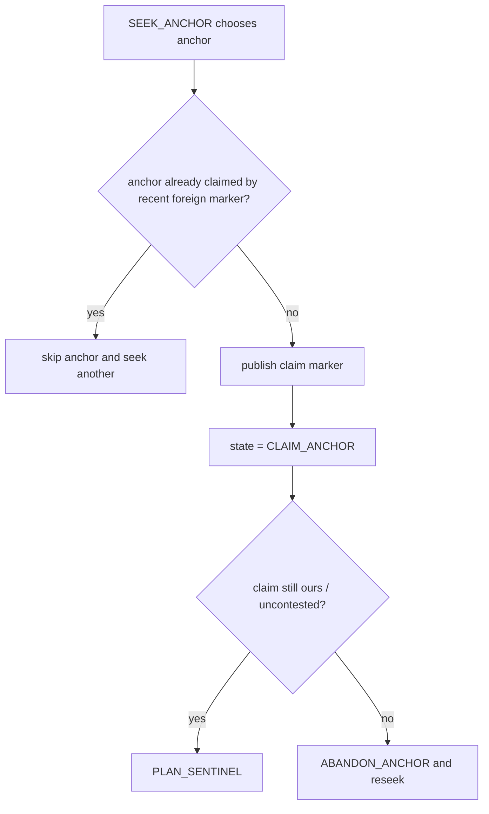
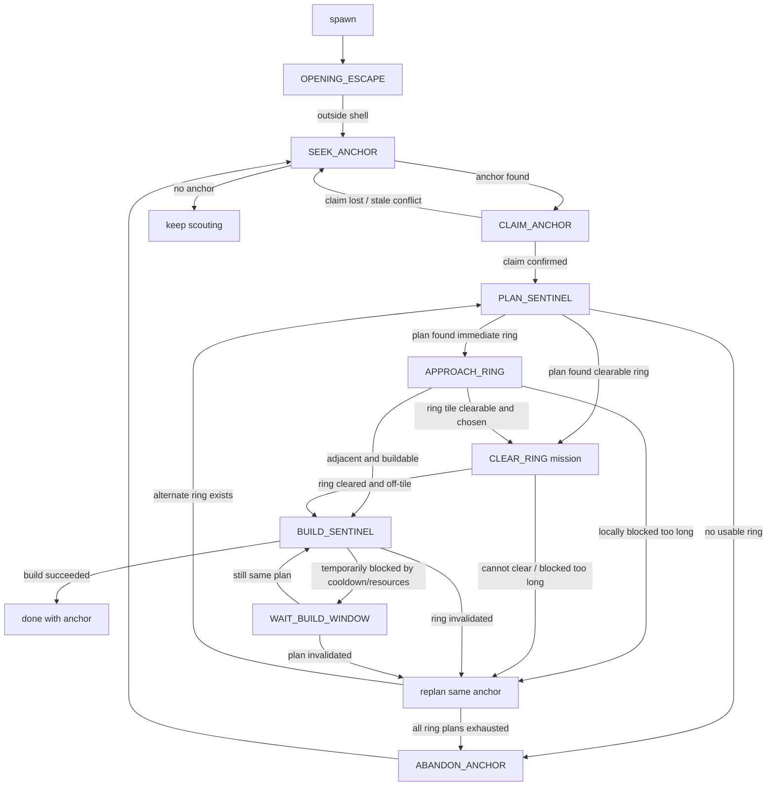
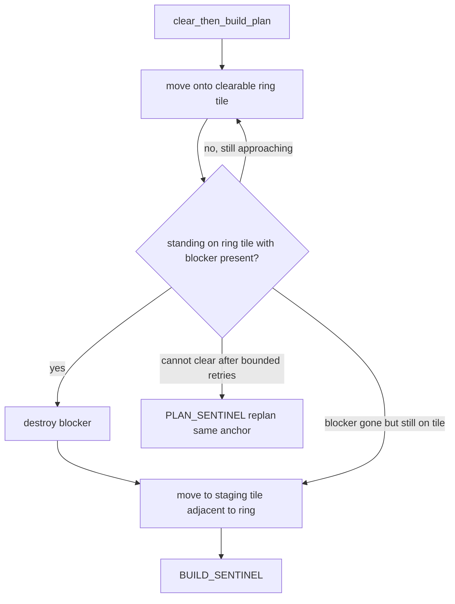
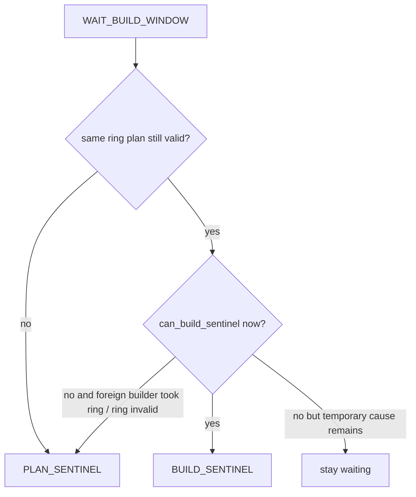

# Assault Overhaul Proposal

FOR CODEX NOT FOR CLAUDE

This document proposes a full simplification of the `jon-6-a6bfs` assault bot based on the issues recorded in [ASSAULT_STATE_MACHINE_REVIEW.md](/Users/benjamin/Documents/CodingProjects/cambridge-battlecode-26/bots/jon-6-a6bfs/ASSAULT_STATE_MACHINE_REVIEW.md).

Core design change:
- Once an assault bot finds a harvester anchor, its mission becomes:
  claim that harvester, choose one ring tile and one facing, clear the ring tile if needed, and build the sentinel.
- The bot should stop switching into broad fallback behavior like `support` or `harass`.
- Navigation should serve that committed mission instead of repeatedly reinterpreting it.

## 1. Goals

The overhaul should optimize for:
- bounded per-turn work
- stable objectives
- no strategy churn from local pathfinding trouble
- real deconfliction between assault bots
- coherent sentinel execution logic

Specifically, the new assault bot should:
- re-enable assault claim markers so only one bot takes a harvester by default
- treat “place a sentinel” as the only real assault objective after anchor acquisition
- commit to clearing a conveyor if that conveyor is on the chosen ring tile
- remove `support` and `harass` as major planner states
- replace “global fallback thinking” with a smaller and more deterministic execution state machine

## 2. High-Level Proposal

### Delete or collapse these current behaviors
- Remove `harass` as a separate state.
- Remove `support` as a separate state.
- Remove “retire anchor because one support attempt failed”.
- Remove random fallback in normal assault travel.
- Stop treating pathfinding failure as evidence of `no_new_value`.

### Keep these ideas
- opening escape from the core shell
- scouting for anchors
- geometry-only ring/direction selection
- committed ring/direction reuse
- local adjacent wait when build is temporarily blocked

### Replace the current assault loop with this one
- `OPENING_ESCAPE`
- `SEEK_ANCHOR`
- `CLAIM_ANCHOR`
- `PLAN_SENTINEL`
- `APPROACH_RING`
- `CLEAR_RING`
- `BUILD_SENTINEL`
- `WAIT_BUILD_WINDOW`
- `ABANDON_ANCHOR`

This is intentionally smaller than the current practical state space.

## 3. Core Behavioral Rule

This is the central behavioral contract for the new bot:

1. Find an anchor.
2. Claim it with a marker.
3. Choose the best ring tile and facing.
4. Lock that plan.
5. If the ring tile is clearable, commit to clearing it.
6. Build the sentinel.
7. Only abandon the anchor if all ring plans fail or the anchor is no longer strategically useful.

That means:
- no “wander around logistics because pathing got weird”
- no “switch to harassment because build approach failed once”
- no “retire a live anchor because support exhausted”

## 4. Marker Proposal

## 4.1 Re-enable assault claim markers

The current code already has the machinery:
- `marker.create_assault_claim_marker`
- `marker.parse_assault_claim_marker`
- `perception` support for decoding nearby assault claims
- `_publish_assault_claim`

But it is effectively disabled because `utils.place_marker_around()` is stubbed.

Proposed fix:
- re-enable `utils.place_marker_around()` for general nearby marker placement
- keep the assault claim refresh interval
- publish claims only after the bot has decided to take an anchor

## 4.2 Claim semantics

Claim scope:
- the claim is for the enemy harvester anchor, not for a ring tile

Claim rules:
- if another recent claim exists on the same anchor, do not choose that anchor
- if the claim is stale, the anchor becomes available again
- if two bots race the same anchor on the same turn, lower builder ID wins the claim
- once a bot owns an anchor claim, it keeps refreshing it while executing the ring plan

This creates the right strategic meaning:
- one assault bot per harvester by default
- less congestion near the same anchor
- less ring-side duplication

## 4.3 Claim lifecycle



## 5. New State Machine

## 5.1 Top-Level Flow



## 5.2 `OPENING_ESCAPE`

Keep the already-landed idea:
- no full bootstrap here
- no random mainline policy
- just exit the spawn shell cheaply

Proposed state contract:
- goal type: `EXIT_SHELL`
- target: cached outward tile
- exit condition: outside core shell

This state is already close to what we want.

## 5.3 `SEEK_ANCHOR`

Purpose:
- choose exactly one harvester to attack

Responsibilities:
- look at visible harvesters first
- otherwise use predicted harvesters / symmetry / frontier
- prefer unclaimed anchors
- prefer anchors with at least one usable ring side
- prefer anchors that produce core or logistics pressure

Non-responsibilities:
- do not decide on harassment targets
- do not enter orbit/sweep behavior
- do not plan multiple strategic options per turn

`SEEK_ANCHOR` should output only:
- `anchor_position`
- `anchor_source` (visible / predicted / frontier)

## 5.4 `CLAIM_ANCHOR`

Purpose:
- turn a chosen anchor into a stable commitment

Responsibilities:
- publish assault claim marker
- reject anchor if another fresh foreign claim is seen
- refresh claim while working

Important:
- this should happen before detailed ring execution
- otherwise multiple builders can still converge and jam the same area

## 5.5 `PLAN_SENTINEL`

Purpose:
- choose one ring tile and one direction

The plan should be:
- `anchor`
- `ring_position`
- `sentinel_direction`
- `ring_mode` in `{IMMEDIATE, CLEARABLE}`
- `blocker_position` if clearable
- `staging_position`
- `plan_revision`
- `failed_ring_positions`
- `no_progress_turns`

This is the state where the user’s intended mechanic becomes explicit:
- after anchor choice, the only question is:
  where do we place the sentinel, and what should it face?

### Ring selection

Evaluate only the 4 ring tiles.

Ring score should use:
- `IMMEDIATE` strongly over `CLEARABLE`
- `CLEARABLE` over blocked
- frontness toward enemy core / local logistics cluster
- distance from current builder
- visible threat penalty
- committed ring stickiness
- whether this side has already failed locally

### Direction selection

Evaluate only a tiny facing set:
- outward
- outward-left
- outward-right

Use the precomputed attack masks and visible enemies:
- high reward for core center
- high reward for turrets
- medium reward for uncovered logistics in the connected cluster
- low or zero reward for already-covered targets
- zero reward for the anchor harvester itself

### Planner output rule

The planner must always choose one of these plan types:
- `immediate_build_plan`
- `clear_then_build_plan`

Not:
- `maybe_build_or_maybe_support`

## 5.6 `APPROACH_RING`

Purpose:
- move toward the exact chosen ring or its staging tile

Responsibilities:
- keep the same plan
- do not reconsider strategic target each turn
- report only local progress / blockage facts

Allowed transitions:
- `APPROACH_RING -> BUILD_SENTINEL` if adjacent and ring is buildable
- `APPROACH_RING -> CLEAR_RING` if ring mode is clearable and we are in clearing position
- `APPROACH_RING -> PLAN_SENTINEL` if the chosen ring becomes invalid
- `APPROACH_RING -> ABANDON_ANCHOR` only after bounded alternate ring exhaustion

Not allowed:
- `APPROACH_RING -> harass`
- `APPROACH_RING -> support`

## 5.7 `CLEAR_RING`

Purpose:
- explicitly clear the chosen ring tile when it contains an enemy passable blocker

This is the state missing from the current bot as a first-class concept.

Current bot behavior:
- if chosen ring is clearable, logic is split between approach, standing-on-ring fire, sidestep, then build

Proposed behavior:
- once the chosen ring is `CLEARABLE`, clearing becomes part of the committed mission

State contract:
- target ring is fixed
- blocker to clear is fixed
- if builder must stand on the ring tile to clear, that is intentional
- after clearing, immediately sidestep to the planned staging tile
- then transition to `BUILD_SENTINEL`



This gives the action a coherent identity:
- “I am clearing this exact ring because I want to build here”
- not “I am temporarily firing at logistics while generally assaulting”

## 5.8 `BUILD_SENTINEL`

Purpose:
- place the sentinel once the ring tile is ready

State contract:
- ring tile is either already open or has just been cleared
- direction is fixed
- bot is on an adjacent staging tile

Transitions:
- build succeeds -> anchor done
- temporarily blocked by cooldown/resources -> `WAIT_BUILD_WINDOW`
- another builder occupies ring -> bounded wait or replan same anchor
- ring becomes invalid -> `PLAN_SENTINEL`

## 5.9 `WAIT_BUILD_WINDOW`

Purpose:
- bounded local wait when the plan is still good but the build is temporarily unavailable

This should replace the current soft `wait_adjacent` logic with a true cheap local state.

Responsibilities:
- do not rerun global anchor selection
- do not rerun scout target logic
- do not run support logic
- only validate:
  same anchor
  same ring
  same staging tile
  same ring availability
  can build yet?



## 5.10 `ABANDON_ANCHOR`

Purpose:
- exit the current anchor commitment cleanly

This should happen only for strategic reasons:
- anchor dead
- anchor already pressured enough by existing sentinel
- all ring plans exhausted
- claim lost

This should not happen because:
- one local move failed
- one support attempt failed
- one path segment looked awkward

## 6. Navigation Overhaul Proposal

The current planner/navigation interface is too weak. The overhaul should make navigation serve explicit goal types.

## 6.1 Introduce goal classes

Instead of passing only `target_pos`, planner should send:
- `goal_type`
- `target_pos`
- `anchor`
- `plan_revision`
- `allow_clearable_target`

Suggested goal types:
- `EXIT_SHELL`
- `SCOUT_FRONTIER`
- `ANCHOR_APPROACH`
- `RING_APPROACH`
- `RING_CLEAR`
- `RING_STAGING`

This matters because navigation failure handling should depend on what the bot is trying to do.

## 6.2 Replace unbounded assault BFS

Proposal:
- remove global unbounded assault BFS as the normal controller
- use a bounded local controller instead

Suggested design:
- direct greedy step if valid and progress-making
- else bounded wall-follow with stable handedness
- else small bounded local search in a radius/window
- else mark goal locally blocked

Key property:
- every assault move decision must be strictly time-bounded

## 6.3 Remove random fallback from normal assault movement

Random fallback should only exist in `OPENING_ESCAPE` as a rare unblocker.

In normal assault:
- if movement fails, keep the same plan and report a blocked-progress event
- do not random-step into unrelated tiles

## 6.4 Track no-progress against the plan, not just position

The new ring plan should record:
- last distance improvement turn
- local loop count
- current blocking reason

Then the planner can make coherent decisions:
- try same ring a bit longer
- switch to alternate ring for same anchor
- abandon anchor only after ring options are exhausted

## 7. What To Delete

The overhaul should strongly consider deleting:
- `harass` state
- `support` state
- `spread_sweep_target` in assault execution
- “retire anchor due to no_new_value after failed support”
- random fallback in `_move_toward`
- anchor assessment logic that reruns the full site planner just to decide liveness

These features add complexity but are not essential to the core objective of building a sentinel.

## 8. Proposed Data Model

Suggested builder fields:

```text
assault_anchor_goal = {
  anchor: (x, y) | None,
  claim_owner_tag: int | None,
  claim_expires_round: int,
  source: "visible" | "predicted" | "frontier" | None,
}

assault_ring_plan = {
  anchor: (x, y) | None,
  ring: (x, y) | None,
  direction: Direction | None,
  ring_mode: "IMMEDIATE" | "CLEARABLE" | None,
  blocker: (x, y) | None,
  staging: (x, y) | None,
  revision: int,
  failed_rings: set[(x, y)],
  no_progress_turns: int,
  last_progress_round: int,
}

assault_nav_goal = {
  goal_type: str | None,
  target: (x, y) | None,
  revision: int,
}
```

This is much easier to reason about than the current combination of:
- `harvester_anchor`
- `assault_committed_site`
- `assault_wait_state`
- `assault_scout_state`
- `assault_nav_state`
- plus implicit subrole transitions

## 9. Why This Should Fix The Observed Problems

### Ping-pong after spawn escape
- stable anchor claim
- stable ring plan
- no `support` / `harass` fallback thrash
- no random move after nav failure

### TLE near walls
- bounded navigation instead of unbounded assault BFS
- no repeated planner resets from local pathing trouble
- no eager transition from site execution failure into broad new behavior

### TLE near conveyors and harvesters
- real anchor deconfliction via markers
- only one builder assigned to an anchor by default
- explicit `CLEAR_RING` instead of generic harassment on logistics tiles
- fewer repeated congestion checks from irrelevant local wandering

## 10. Recommended Implementation Order

1. Re-enable assault claim markers and enforce claim-aware anchor selection.
2. Delete `harass` and `support` from the main assault loop.
3. Introduce explicit `PLAN_SENTINEL`, `CLEAR_RING`, `BUILD_SENTINEL`, and `WAIT_BUILD_WINDOW`.
4. Separate anchor abandonment from movement failure.
5. Replace unbounded assault BFS with a bounded local controller.
6. Remove random fallback from normal assault travel.

## 11. Success Criteria

The overhaul is successful if:
- assault bots stop entering long 2/3-tile loops after spawn escape
- wall-side turns stop producing repeated `~2100 us` server timings
- anchor claims visibly deconflict assault builders
- assault bots always look like they are doing one coherent thing:
  taking a harvester, clearing a ring if needed, and building a sentinel
- the state machine becomes explainable without hidden fallback layers
