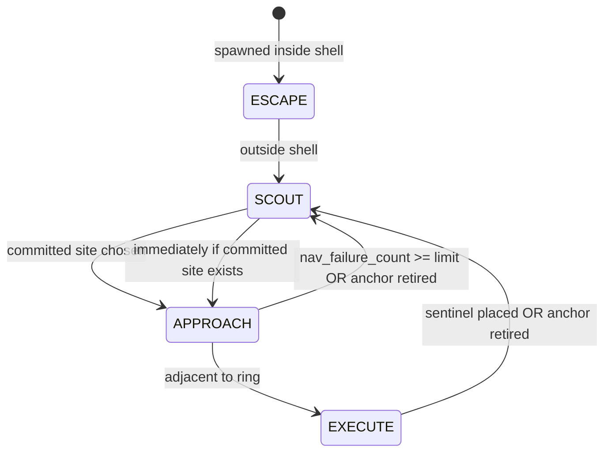
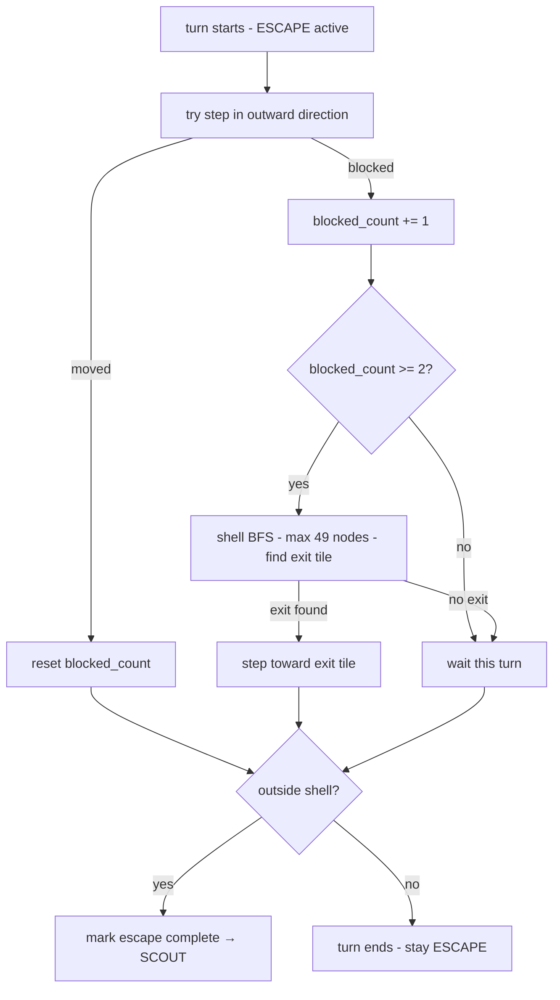
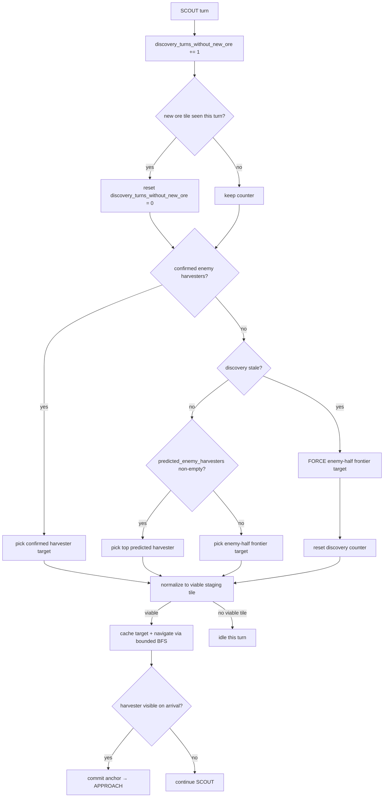
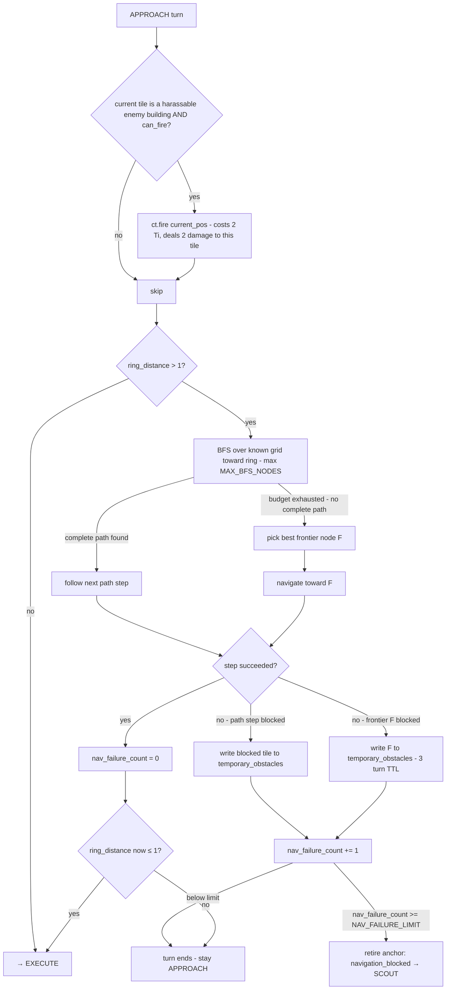
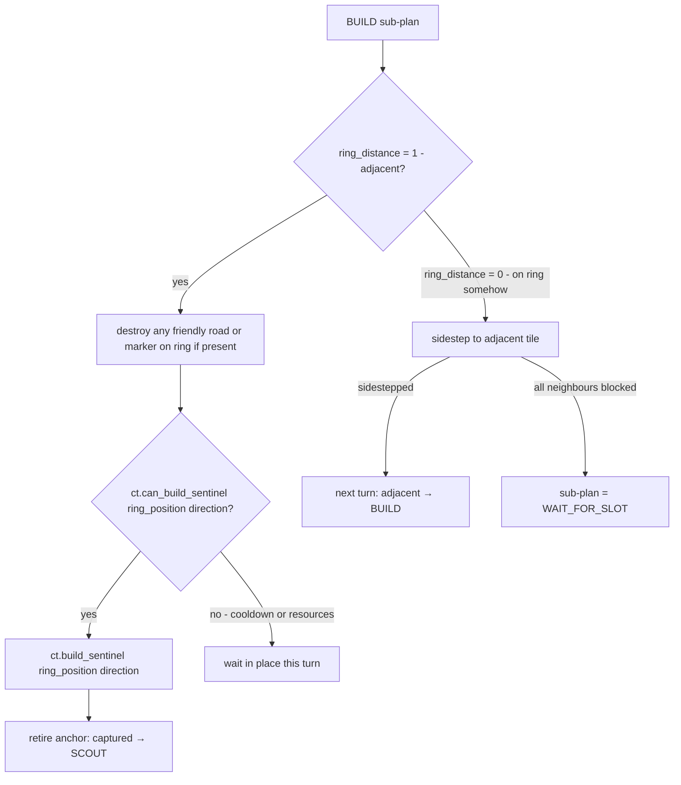
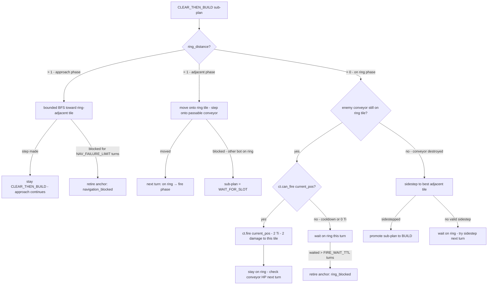
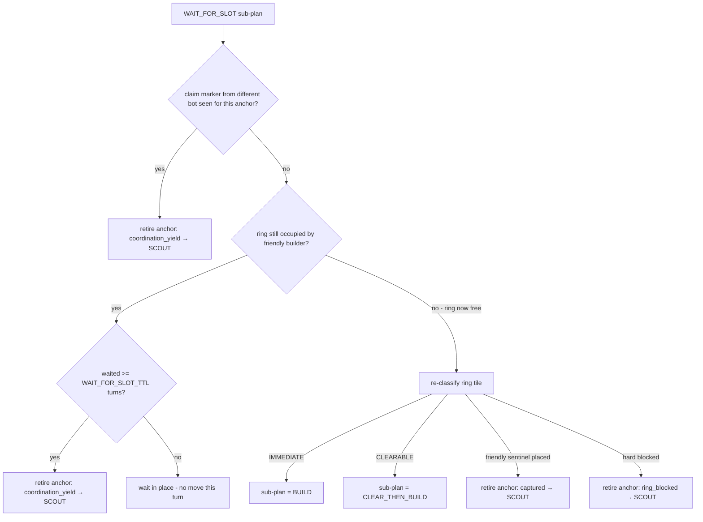
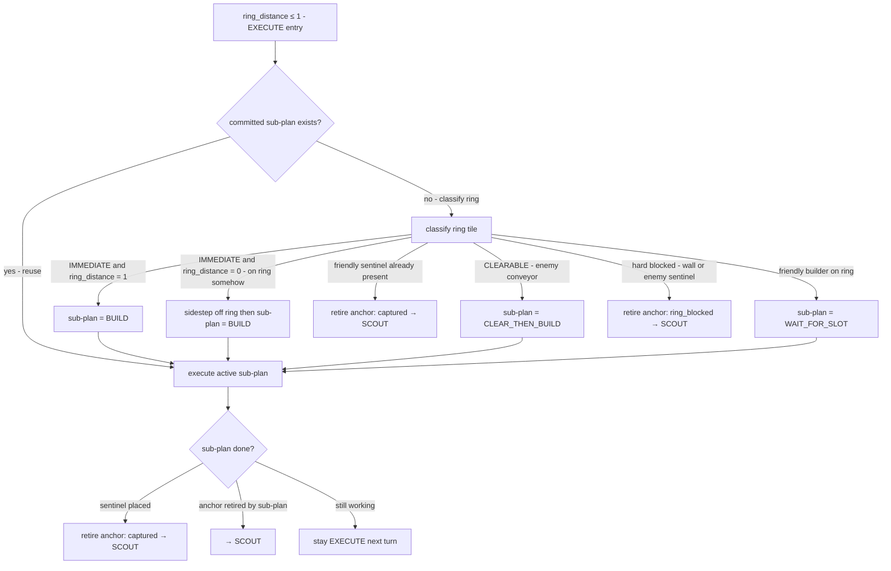
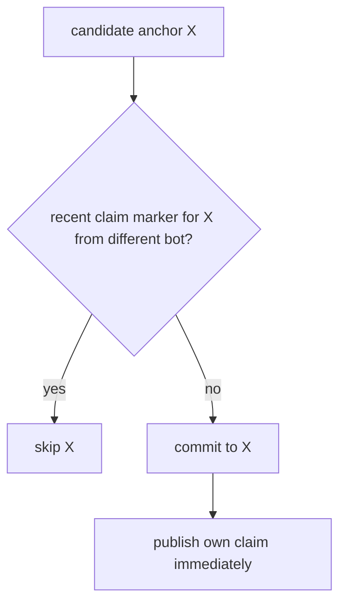
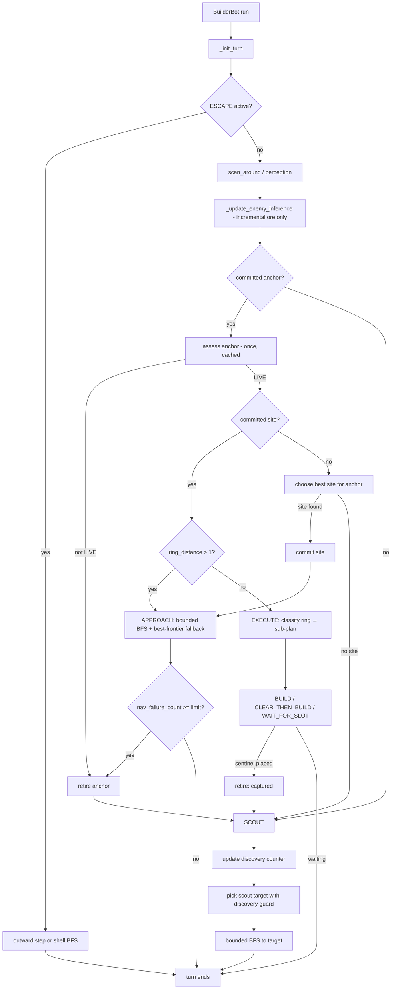

# This proposal is what jon-6-a7bfs and jon-6-a8bfs is based on
# Proposed Overhaul: `jon-6-a5bfs` Assault State Machine

This document proposes a concrete redesign of the assault control flow to address the failure modes identified in `ASSAULT_STATE_MACHINE_REVIEW.md`. The guiding principle is: **fewer states, explicit contracts between layers, bounded navigation, and anchor retirement driven by strategy facts rather than movement failure**.

---

## 0. Summary of Changes

| Problem | Proposed Fix |
|---|---|
| `harass` / `support` overlap and aggressive anchor retirement | Collapsed: `APPROACH` does opportunistic fire; retire only on confirmed strategy reasons |
| Navigation failure → anchor retirement | `nav_failure_count` counter; retire only after `NAV_FAILURE_LIMIT` consecutive blocked turns |
| Unbounded assault BFS | Cap BFS at `MAX_BFS_NODES` over **full known grid**; fall back to best-frontier waypoint |
| Bug-2 / BFS thrash creating 2–3 tile ping-pong | **Drop Bug-2 entirely**; best-frontier fallback has no wall-follow state to oscillate |
| Random fallback after structured nav failure | **Eliminated**; best-frontier fallback always makes meaningful progress |
| `wait_adjacent` not a sealed state | Replaced with proper `EXECUTE` phase with explicit sub-plans |
| Sentinel placement logic escapable | Commit to `CLEAR_THEN_BUILD` or `BUILD` sub-plan; enemy conveyor on ring is expected, not a retreat trigger |
| Assault claims never published (`place_marker_around` stubbed) | Use `place_assault_marker_around` (already live) |
| Scout prediction set is closed — bot cycles between same N targets | `discovery_turns_without_new_ore` counter; force enemy-half frontier when stale |
| `connected_friendly_harvesters` O(G) full grid scan every turn | **Drop it**; use `_candidate_ore_sources(bot)` (ore positions, already maintained, O(1)) |
| `evaluate_symmetry_modes` sorts full grid every 8 turns | Cache sorted `informative_tiles`; invalidate only when new env data added |
| `assess_anchor()` duplicates site planner | Call once per `execute()`, cache; do not re-call from within EXECUTE |
| Temporary obstacle stuck on same frontier node | Failed frontier node written to `temporary_obstacles` (5-turn TTL, up from 3) |
| `WAIT_FOR_SLOT` dual-retirement race (timeout + claim marker both fire) | Claim marker check runs **inside** EXECUTE before timeout; timeout only fires if no claim seen |
| `CLEAR_THEN_BUILD` movement phase ambiguous | Explicit bounded BFS to adjacent ring tiles; best-frontier fallback when budget exhausted; fire guard if not adjacent |

---

## 1. New Top-Level State Machine

Replace the six subroles with **four clean states**:

```
ESCAPE → SCOUT → APPROACH → EXECUTE
```

Transitions are driven by whether the bot has a committed anchor/site and how close it is to the ring.



### 1.1 State Responsibilities

| State | Enters when | Exits when | Per-turn work |
|---|---|---|---|
| `ESCAPE` | Spawn position inside core shell | Outside shell | Outward movement only; inference skipped (no data yet, not a cost concern) |
| `SCOUT` | No committed site | Committed site chosen | Enemy inference; discovery tracking; pick target; bounded BFS travel |
| `APPROACH` | Committed site, ring_distance > 1 | ring_distance ≤ 1 OR anchor retired | Bounded BFS toward ring; opportunistic fire **if currently standing on** a harassable enemy tile |
| `EXECUTE` | ring_distance ≤ 1 | Sentinel placed OR anchor retired | Move onto ring if needed; clear conveyor by firing own tile; sidestep off; build sentinel from adjacent |

---

## 2. `ESCAPE` State — Simplified

The only goal of ESCAPE is to leave the spawn shell with minimal overhead. Enemy inference is **not gated for performance reasons** — after the performance fixes, `_update_enemy_inference` costs ~10–20 μs during escape (empty grid, no ore seen, no enemy data). It is skipped because **it produces nothing useful**: inside the spawn shell the bot has seen only its own core tiles, so predictions and symmetry data are noise. Running the full SCOUT decision machinery (frontier scan, anchor selection, BFS target calculation) would add ~60–100 μs per turn for 4–5 turns to produce the same result as "walk outward."

**Algorithm:**
1. Compute spawn outward direction once from `_spawn_shell_vector` (stored, never recomputed).
2. Each turn: try to step in that direction.
3. If the step fails: run a BFS capped to the shell area only (`max_nodes = SHELL_MAX_TILES ≈ 49`). Find the nearest tile outside the shell. Navigate there.
4. No random fallback in escape — a 49-node BFS over the tiny shell will always find an exit if one exists.
5. Once outside shell: set `assault_opening_escape_complete = True`. Enter SCOUT.

The current `_bootstrap_target` geometry (computing exact shell-perimeter candidates, scoring by side_mismatch, alignment, etc.) is **removed**. The outward vector + tiny shell BFS is sufficient and O(49) instead of O(shell² × candidates).



---

## 3. `SCOUT` State

### 3.1 Target Selection — Two Sources with Discovery Guard

The current scout target selection has too many overlapping sources (legacy sweep, global frontier, local frontier, predicted harvesters, etc.) leading to the closed-prediction cycling failure: the bot rotates between the same N symmetry-predicted tiles, never sees new territory, and never grows the prediction set.

**New rule:** use exactly two sources, with a discovery counter that forces frontier exploration when predictions are stale.

#### Discovery counter

```python
bot.discovery_turns_without_new_ore: int
# Increments every SCOUT turn. Resets to 0 when any new ore tile enters bot.grid.
```

#### Target selection logic

```
DISCOVERY_STALE_THRESHOLD = 20  # turns without new ore → force frontier

if confirmed_enemy_harvesters non-empty:
    → always pick confirmed target (highest confidence, go directly)
elif discovery_turns_without_new_ore <= DISCOVERY_STALE_THRESHOLD:
    → pick best prediction from predicted_enemy_harvesters
       (if prediction list empty, pick frontier)
else:
    → FORCE: pick enemy-half frontier target
    → reset discovery_turns_without_new_ore = 0
```

This prevents the cycling failure: after `DISCOVERY_STALE_THRESHOLD` turns of navigating between known predictions without seeing new ore, the bot is forced to explore new territory. Confirmed harvesters bypass the guard entirely — direct observation always takes priority.

#### Prediction source — drop `connected_friendly_harvesters`

`connected_friendly_harvesters` scans the full `bot.grid` every turn (O(G), ~300–500 μs on large maps) to find friendly harvesters adjacent to conveyors. **Drop it entirely.**

Replace with `_candidate_ore_sources(bot)`, which returns ore positions from `bot.titanium_locations` (already maintained incrementally, O(1) per turn, capped at 6). Since every harvester sits on ore, mirroring ore positions gives equivalent or better predictions than mirroring connected harvesters.

Delete the `known_connected_harvesters` bot state field. Update `build_predicted_enemy_harvesters` to accept `remembered_ores` directly (it already does — just stop passing `connected_friendly_harvesters` as a separate argument).

#### Frontier target: enemy-half only

The forced frontier target must be on the **enemy half of the map** (tiles closer to `enemy_core_anchor` than to `core_pos`). Exploring our own half does not expand the prediction set.



### 3.2 Claim Marker Re-enable

**Bug fix**: `_publish_assault_claim` calls `utils.place_marker_around`, which is permanently stubbed to return `False`. Change to `utils.place_assault_marker_around` (already live and functional).

```python
# CURRENT (broken):
if utils.place_marker_around(ct, ct.get_position(), marker_value):
    ...

# FIXED:
if utils.place_assault_marker_around(ct, ct.get_position(), marker_value):
    ...
```

Publish whenever the bot commits to an anchor (APPROACH entry) or holds EXECUTE position. With this fixed, `_is_locally_claimed_assault_anchor` will actually receive real data, and multiple assault bots will stop converging on the same harvester.

---

## 4. `APPROACH` State

### 4.1 Navigation Algorithm — Bounded BFS with Best-Frontier Fallback

**Drop Bug-2 entirely.** Bug-2 was designed for robots with no map knowledge. This bot has a persistent grid and full memory of seen tiles. Bug-2's wall-follow state is the direct cause of the 2–3 tile oscillation loops identified in the v3 replays.

**New algorithm:**

1. BFS over `bot.grid` (all known tiles), treating unseen tiles as tentatively passable.
2. Cap at `MAX_BFS_NODES = 256`. At 256 nodes, the BFS covers roughly a 9-tile radius — full planning depth within vision.
3. **During BFS, track the frontier** (the open queue nodes not yet expanded). The BFS must maintain this set explicitly — it cannot be reconstructed after the fact.
4. If BFS finds a complete path to target: follow it.
5. If BFS exhausts budget or empties the queue without reaching target (**best-frontier fallback**):
   - Pick the frontier node `F` that minimises `heuristic(F, target)` (Chebyshev distance).
   - Navigate toward `F` as an intermediate waypoint this turn.
   - If navigation to `F` fails: write `F` into `temporary_obstacles` (5-turn TTL) so next turn's BFS picks a different frontier node.
   - **Edge case — all frontier nodes blocked:** if `temporary_obstacles` contains all frontier nodes, do not increment `nav_failure_count` yet. Instead, wait one turn in place (the temporary obstacles will partially expire) and retry next turn.
6. If no move succeeds at all and frontier is exhausted: `nav_failure_count += 1`.

The best-frontier fallback naturally navigates around walls of any size: the BFS explores up to the visible extent of the wall, the frontier node closest to the target is at the end of the wall, and the bot navigates toward the gap as it becomes visible each turn. No wall-follow state required.



### 4.2 Navigation Failure Contract — Two Separate Counters

A single "failed step" counter is insufficient. There are two distinct failure modes that require different detection:

| Failure | Description | Fires fast or slow? |
|---|---|---|
| **Step blocked** | Move physically failed (wall, friendly bot) | Fast: limit 8 |
| **Progress stalled** | Successful moves but no approach to target | Slow: limit 40 |

The step-blocked counter alone misses the case where the bot makes successful moves but cycles without closing in on the target — e.g., oscillating between two equidistant frontier nodes, or navigating inside a concave obstacle without finding the exit.

**Counter 1: `nav_failure_count`** — increments when a step is physically blocked. Resets on any successful move. Limit: `NAV_FAILURE_LIMIT = 8`.

**Counter 2: `nav_progress_stall_count`** — increments when Chebyshev distance to target did not decrease this turn. Resets when distance improves (`current_dist < best_dist_seen_since_target_set`). Limit: `PROGRESS_STALL_LIMIT = 40` (must tolerate long detours on comb/maze maps — a 15-tile slab requires ~30-tile detour around the bottom corridor).

```python
# Each APPROACH turn, after any move attempt:
current_dist = chebyshev(ct.get_position(), ring_target)
if current_dist < bot.assault_best_dist_to_ring:
    bot.assault_best_dist_to_ring = current_dist
    bot.assault_progress_stall_count = 0
else:
    bot.assault_progress_stall_count += 1
```

Both counters reset when the committed site changes.

Anchor retirement from APPROACH:
- `nav_failure_count >= NAV_FAILURE_LIMIT` → `navigation_blocked`
- `nav_progress_stall_count >= PROGRESS_STALL_LIMIT` → `navigation_blocked`
- Anchor assessment returns non-LIVE → assessment status string

---

## 5. `EXECUTE` State — Coherent Sentinel Placement

The current code mixes "I can't build yet" with "this site is wrong" and exits unpredictably. The new design commits to a **sub-plan** on EXECUTE entry and follows it to completion.

### 5.1 Sub-Plan Selection on EXECUTE Entry

| Ring tile state | Sub-plan |
|---|---|
| `IMMEDIATE` (empty/passable) | `BUILD` |
| `CLEARABLE` (enemy conveyor present) | `CLEAR_THEN_BUILD` |
| Friendly sentinel already present | `DONE` → retire anchor: `captured` → SCOUT |
| Other friendly builder on ring | `WAIT_FOR_SLOT` |
| Hard blocked (wall, enemy sentinel, non-clearable) | retire anchor: `ring_blocked` → SCOUT |

The sub-plan is persisted in bot state (`assault_execute_subplan`) and survives across turns. It does not get re-evaluated from scratch each turn — only specific events can change it (conveyor destroyed → promote from `CLEAR_THEN_BUILD` to `BUILD`; ring newly occupied → transition to `WAIT_FOR_SLOT`).

### 5.2 `BUILD` Sub-Plan

The bot is adjacent (ring_distance = 1) and the ring tile is clear. The sentinel is **built from adjacent** — the builder calls `ct.build_sentinel(ring_position, direction)` while standing next to the ring. It does NOT need to step onto the ring tile to build.



The bot should never need to stand on the ring tile during BUILD — it was placed adjacent by APPROACH. The "on ring" branch handles the rare case where the bot ended up on the ring tile (e.g., after the CLEAR_THEN_BUILD fire sequence completes on the same turn the conveyor dies).

### 5.3 `CLEAR_THEN_BUILD` Sub-Plan

The ring tile has an enemy conveyor. **The bot commits to destroying it.** This is expected and not a reason to retreat.

**Critical mechanic:** `ct.fire()` attacks the **builder's own current tile only** at a cost of 2 Ti for 2 damage. The builder cannot fire an adjacent tile. To destroy a conveyor on the ring, the builder must **step onto the ring tile** (conveyors are passable) and fire from on top of it. After destroying the conveyor the builder sideSteps to adjacent and then builds the sentinel.

Three phases: **approach to adjacent → step onto ring and fire → sidestep off ring → promote to BUILD**.



Key invariants:
- The conveyor may require **multiple fire turns** to destroy (builder does 2 damage/fire; conveyor HP may exceed 2).
- Each fire costs 2 Ti. This is a real resource expenditure; do not fire unless conveyor destruction is the goal.
- `FIRE_WAIT_TTL = 5`: if the bot is on the ring but cannot fire for 5 consecutive turns (e.g., Ti shortage), retire rather than deadlock.
- After sidestep, ring tile is empty → BUILD sub-plan takes over from adjacent position.

### 5.4 `WAIT_FOR_SLOT` Sub-Plan

Entered when a friendly builder occupies the ring tile. Limited to `WAIT_FOR_SLOT_TTL` turns to avoid deadlock.

**Important:** the claim marker check must run **inside** this sub-plan, not only at SCOUT entry. If another bot's claim marker is seen while waiting, retire immediately (do not wait for the timeout). This prevents the dual-retirement race where timeout and claim detection both fire at the same turn, leaving an anchor unclaimed by anyone.



**Dual-retirement safety:** when Bot A retires via `coordination_yield` because it saw Bot B's claim marker, Bot B is committed and publishing claims. Bot B will NOT also be in `WAIT_FOR_SLOT` for the same ring at the same time — it is the one occupying the ring, so it is in the `BUILD` sub-plan. The race cannot produce a double-retirement if the claim check is the first branch evaluated.

### 5.5 Complete EXECUTE Entry Flow

Note: EXECUTE is entered when `ring_distance ≤ 1`, meaning the bot is either **adjacent** (distance = 1) or **on** the ring tile (distance = 0). The sub-plan selection accounts for both positions.



---

## 6. Anchor Lifecycle — Retire on Strategy Facts Only

Remove the coupling between navigation failure and anchor retirement.

| Reason | Trigger | State |
|---|---|---|
| `captured` | Friendly sentinel on ring OR assessment confirms captured | EXECUTE |
| `dried` | Assessment: harvester gone, tile visible and empty | SCOUT / APPROACH |
| `saturated` | Assessment: all ring sides have friendly sentinels | SCOUT / APPROACH |
| `good_enough` | Assessment: pressure established + marginal value near zero | SCOUT / APPROACH |
| `ring_blocked` | Ring tile is permanently non-clearable at EXECUTE entry | EXECUTE |
| `navigation_blocked` | `nav_failure_count >= NAV_FAILURE_LIMIT` | APPROACH |
| `coordination_yield` | Another bot's claim marker seen for this anchor | SCOUT / APPROACH |
| `wait_timeout` | `WAIT_FOR_SLOT_TTL` exceeded | EXECUTE |

**Removed retirement reasons:**
- `no_new_value` — was triggered by a single failed support turn. Eliminated.
- `local stall` — replaced by `navigation_blocked` with explicit counter.
- `support stall` — replaced by `navigation_blocked`.

---

## 7. Claim Marker Protocol

### 7.1 Publication

Publish `ASSAULT_CLAIM` marker encoding `(anchor_position, owner_tag, round)` every `ASSAULT_CLAIM_REFRESH_INTERVAL` turns when in APPROACH or EXECUTE.

### 7.2 Consumption

Before committing to an anchor in SCOUT, check if `_is_locally_claimed_assault_anchor` returns true for it. If claimed by another bot with a recent marker, skip and try the next candidate.



### 7.3 TTL

Claim markers expire after `ASSAULT_CLAIM_REFRESH_INTERVAL * 3` turns. If the owning bot dies or retires the anchor, it stops refreshing and the claim naturally expires, freeing the anchor for other bots.

---

## 8. Navigation Layer Contract

```
assault_navigate(bot, ct, target) → (moved: bool, failure_reason: str | None)

failure_reason:
  None               — success
  "frontier_blocked" — best frontier node was blocked; written to temporary_obstacles
  "no_moves"         — no legal move available at all
```

The planner increments `nav_failure_count` on any non-None failure_reason. The navigator:
- Never calls `move_random`
- Never enters Bug-2
- On BFS budget exhaustion or no path found: picks best frontier node, navigates toward it
- On frontier node blocked: marks it in `temporary_obstacles` (5-turn TTL), returns `"frontier_blocked"`
- If ALL frontier nodes are in `temporary_obstacles`: wait in place this turn; do not increment `nav_failure_count`

Temporary obstacle TTL is **5 turns** (increased from the existing 3). The increase prevents the 3-turn sub-cycling failure where a blocked frontier node expires and is retried before `NAV_FAILURE_LIMIT` is reached, creating artificial failure pressure. 5 turns is still short enough to re-route around a bot that moves away.

---

## 9. Performance Fixes

### 9.1 Drop `connected_friendly_harvesters` — saves ~300–500 μs/turn on large maps

```python
# REMOVE from _update_enemy_inference:
connected_harvesters = assault.connected_friendly_harvesters(
    grid=bot.grid, my_team=ct.get_team(), connected_conveyors=...
)
bot.known_connected_harvesters.update(...)

# REPLACE with:
ore_sources = _candidate_ore_sources(bot)  # already O(1), capped at 6
# pass ore_sources to build_predicted_enemy_harvesters as remembered_ores
```

Also delete `bot.known_connected_harvesters` state field entirely.

**Why equivalent:** every harvester sits on ore. Mirroring ore positions (which the bot already tracks) gives equivalent predictions to mirroring connected harvesters. The "connected" qualifier was a confidence filter irrelevant to assault targeting.

### 9.2 Cache symmetry `informative_tiles` sort — saves ~500 μs on trigger turns

`evaluate_symmetry_modes` currently builds and sorts a list of all grid tiles with env data on every call (every 8 turns). Since terrain is static (walls never move), the sorted list can be cached and invalidated only when new `env` data is first recorded for a tile:

```python
# Bot state: bot.symmetry_tile_cache = None | sorted list
# Invalidate when: a new (x,y) key with env != None enters bot.grid
# If cache valid: skip the build+sort, use cached list directly
```

### 9.3 `_update_enemy_inference` during ESCAPE

After performance fixes, inference costs ~10–20 μs during escape (empty grid, trivial inputs). The existing early-return guard (`if _execute_opening_escape: return`) can be **removed** — it is no longer needed for performance, and inference during escape is harmless. The escape state skips inference for strategic simplicity only (no data → no useful output), and that logic lives in the ESCAPE state itself, not as a guard around the inference call.

### 9.4 Performance budget summary (large map, mid-game, G ≈ 1000 tiles)

| Component | Before | After |
|---|---|---|
| `connected_friendly_harvesters` | ~350 μs/turn | **0 μs** (dropped) |
| `evaluate_symmetry_modes` (amortised) | ~70 μs/turn | ~15 μs/turn (cached sort) |
| `build_predicted_enemy_harvesters` | ~80 μs/turn | ~80 μs/turn (unchanged) |
| **`_update_enemy_inference` total** | **~500 μs/turn** | **~100 μs/turn** |

---

## 10. Remove / Simplify

### Remove
- `connected_friendly_harvesters` call and `known_connected_harvesters` state field
- Bug-2 wall-follow logic from `assault_move_towards` (`calculate_bug_nav`, `_choose_bug_follow_direction`, `_start_bug_follow`)
- `harass` subrole (collapsed into APPROACH opportunistic fire)
- `support` subrole (not needed with simplified EXECUTE)
- `no_new_value`, `local stall`, `support stall` retirement reasons
- `move_random` call in `_move_toward`
- `spread_sweep_target` call from SCOUT target selection
- `_bootstrap_target` shell-perimeter geometry (replaced by simple outward vector + shell BFS)

### Simplify
- `wait_adjacent` → proper `WAIT_FOR_SLOT` sub-plan with explicit turn counter
- `assess_anchor` → called once at start of `execute()`, cached in `_aa_cache`, not re-called from within EXECUTE
- `_is_connected_to_harvester` — still needed for logistics avoidance; cap DFS depth at 16 nodes

---

## 11. Updated Full Control Flow



---

## 12. Constants Summary

| Constant | Value | Rationale |
|---|---|---|
| `MAX_BFS_NODES` | 256 | Full planning within ~9-tile radius; bounded cost on 40×40 |
| `NAV_FAILURE_LIMIT` | 8 | Tolerates transient congestion; step-blocked counter |
| `PROGRESS_STALL_LIMIT` | 40 | Catches frontier oscillation and concave-obstacle loops; must tolerate ~30-turn detours on comb maps |
| `WAIT_FOR_SLOT_TTL` | 5 | Yield after 5 turns if ring still blocked by teammate |
| `FIRE_WAIT_TTL` | 5 | Give up on CLEAR_THEN_BUILD fire phase after 5 adjacent turns without firing |
| `DISCOVERY_STALE_THRESHOLD` | 20 | Force frontier after ~20 scout turns without new ore; tune down for wall-heavy maps |
| `ASSAULT_CLAIM_REFRESH_INTERVAL` | 4 | Unchanged |
| `ASSAULT_CLAIM_TTL` | 12 | 3× refresh interval |
| `ASSAULT_OBJECTIVE_TTL` | 16 | Unchanged |
| `ASSAULT_BLACKLIST_TTL` | 28 | Unchanged |
| Temporary obstacle TTL | **5 turns** | Increased from 3; prevents 3-turn sub-cycling vs. 8-turn NAV_FAILURE_LIMIT |

---

## 13. Files to Modify

| File | Change |
|---|---|
| `mode_assaulting.py` | Main redesign: 4-state machine, EXECUTE sub-plans, discovery counter, drop `connected_friendly_harvesters`, fix claim marker stub, claim check inside `WAIT_FOR_SLOT` |
| `navigation.py` | Cap BFS at `MAX_BFS_NODES`; **track frontier set during BFS** (keep open-queue nodes at budget exhaustion); add best-frontier fallback; remove Bug-2; remove `move_random` fallback; increase temp obstacle TTL 3→5 |
| `assault.py` | Drop `connected_friendly_harvesters` call; cache `informative_tiles` sorted list in `evaluate_symmetry_modes` |
| `utils.py` | `_publish_assault_claim`: change `place_marker_around` → `place_assault_marker_around` |

---

## 14. Game Mechanics Reference (Cambridge Battlecode Rules That Affect This Design)

These facts from the game rules directly constrain the design. Any implementation that contradicts these is wrong.

| Mechanic | Rule | Implication for assault |
|---|---|---|
| Builder `fire()` | Attacks **current tile only**; costs 2 Ti; deals 2 damage | Cannot fire adjacent tiles. To destroy a ring conveyor, bot must step ONTO it first |
| Builder `build_sentinel(pos, dir)` | Built from **adjacent** tile; sentinel placed at `pos` | Bot stays adjacent, places sentinel on ring tile. Never needs to step onto ring to build |
| Conveyors | **Passable** for movement | Bot can step onto enemy conveyor freely. Ring with conveyor = accessible, not blocked |
| `can_fire_from(pos, dir, type, target)` | **Turret geometry query** only — checks if a sentinel/gunner at `pos` can hit `target` | NOT a builder fire method. Used only for site-ranking, not execution |
| Markers | Free, no cooldown, 1 per round per unit, readable by allies | Use `place_assault_marker_around` (live). One marker per assault bot per turn |
| `fire()` cost | 2 Ti per fire | Destroying a conveyor is not free. At 2 HP/fire, a conveyor with e.g. 10 HP costs 10 Ti to clear. Budget this |
| Turret shots vs builders on buildings | "turret attacks hit only the builder bot if one stands on the building" | Do not stand on a ring tile while an enemy sentinel can reach it |

## 16. What This Does NOT Change

- `AssaultSite`, `AnchorAssessment`, `PredictedHarvester` data structures
- Site ranking logic (`choose_best_site_for_harvester`, `rank_assault_sites_for_harvester`)
- Conveyor topology refresh (still needed for logistics bots)
- Perception / chunk tracking / `explored_chunk_last_seen`
- Symmetry evaluation logic (just caches the sort)

---

## 17. Expected Outcomes

| Symptom | Root cause fixed |
|---|---|
| Ping-pong 2–3 tile loops | Bug-2 removed; no wall-follow state; best-frontier always moves meaningfully |
| TLE near walls | Bounded BFS (256 nodes); no BFS/Bug thrash; no unbounded region scan |
| TLE on conveyor next to harvester | `WAIT_FOR_SLOT` avoids repeated approach; `connected_friendly_harvesters` eliminated |
| Scout cycles between same N predictions | Discovery counter forces enemy-half frontier exploration after `DISCOVERY_STALE_THRESHOLD` turns |
| Multiple bots converging on same anchor | Claim markers actually published → deconfliction works |
| Anchor retired after one failed support turn | `no_new_value` / `support stall` removed; `navigation_blocked` requires 8 consecutive failures |
| Sentinel never placed despite enemy conveyor on ring | `CLEAR_THEN_BUILD` commits to clearing; conveyor on ring is expected and not a retreat trigger |
